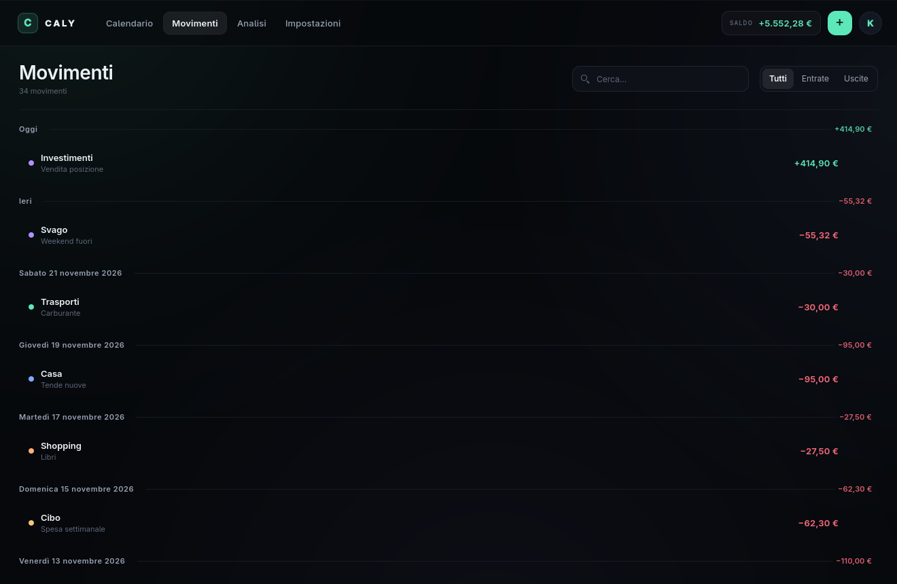
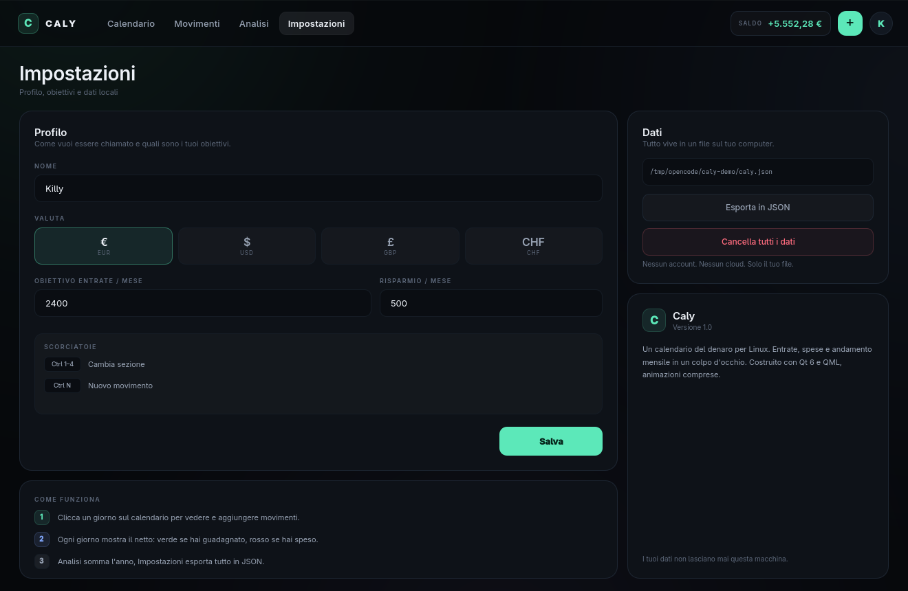
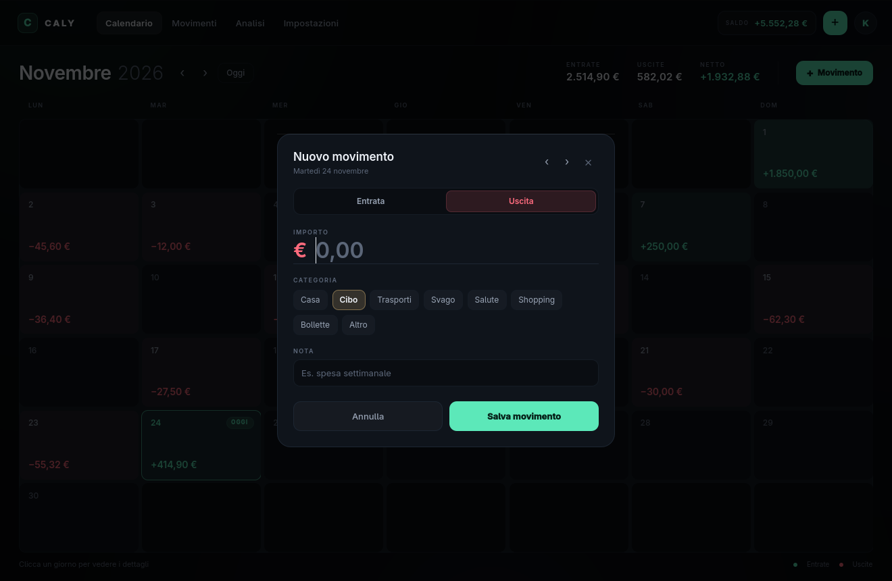

<div align="center">


<h1>Caly</h1>

<p><strong>Your money, day by day.</strong><br/>
A money calendar for Linux. Dark, fast, local.</p>

[](https://qt.io)
[](#)
[](#)
[](#license)


</div>

---

## Why Caly

Spreadsheets lie. An expense becomes a row, the month becomes a column, and by
the end of it you no longer know where the money went. Caly flips the view: the
month is a grid, every day shows its net, green or red, with an intensity
proportional to what came in or went out. One glance and you know how November
went.

Everything lives in a single JSON file on your machine. No account, no cloud,
no telemetry.

## Features

**Calendar**
Monday-first month grid, per-day net with proportional intensity, today
highlighted, a side panel with the day's transactions, quick add and delete
with confirmation.

**Transactions**
Day-grouped list with running totals, instant search, filters for all / income
/ expenses.

**Insights**
Year income, expenses, net and savings rate; animated monthly flow bars;
spending breakdown by category.

**Settings**
Name, currency (€, $, £, CHF), monthly targets, JSON export, data reset with
confirmation.

**Onboarding**
Four steps: greeting, name, currency, targets, optional sample data. Enter
animations, Enter to advance, Esc to go back.

**Yours only**
One file, atomic writes via `QSaveFile`, zero network. The path is shown in
settings and can be overridden with `CALY_DATA_DIR`.

The interface is in Italian.

## Screenshots

<div align="center">

| Onboarding | Transactions |
|:---:|:---:|
|  |  |

| Insights | Settings |
|:---:|:---:|
|  |  |

| New transaction | |
|:---:|:---:|
|  | |

</div>

## Installation

You need **Qt 6.5+** with the Core, Gui, Qml, Quick and QuickControls2 modules,
plus CMake and a C++20 compiler.

**Debian / Ubuntu**

```bash
sudo apt install cmake g++ qt6-base-dev qt6-declarative-dev qml6-module-qtquick-controls
```

**Arch**

```bash
sudo pacman -S cmake gcc qt6-base qt6-declarative
```

**Build**

```bash
cmake -S . -B build -DCMAKE_BUILD_TYPE=Release
cmake --build build -j"$(nproc)"
./build/caly
```

**Install system-wide (optional)**

```bash
sudo cmake --install build --prefix /usr/local
```

This installs the binary, the icon and the desktop entry.

## Data

```
~/.local/share/caly/caly.json
```

Override it with `CALY_DATA_DIR`:

```bash
CALY_DATA_DIR=/tmp/try ./build/caly
```

JSON exports go to `~/Documents`.

## Shortcuts

| Key | Action |
|---|---|
| `Ctrl+1` … `Ctrl+4` | Switch section |
| `Ctrl+N` | New transaction |
| `Enter` | Advance onboarding |
| `Esc` | Back in onboarding, close confirmations |

## Development

Flags built for screenshots and automated checks:

```bash
./build/caly --demo                    # demo profile with three months of data
./build/caly --reset                   # wipe data before launch
./build/caly --screenshot out.png --delay 1800
./build/caly --page 2                  # open a section (0-3)
./build/caly --open-dialog             # open the new-transaction dialog
./build/caly --open-day                # open today's panel
./build/caly --onboarding-step 2       # onboarding at a given step (0-3)
./build/caly --autopilot               # complete onboarding automatically
./build/caly --auto-add                # save a test transaction
./build/caly --auto-delete             # open the delete confirmation
./build/caly --selftest                # backend tests, exit code 0/1
```

The `--selftest` suite covers onboarding, adding and removing transactions,
monthly summaries, export and reset.

## Project layout

```
src/backend.{h,cpp}       profile, transactions, JSON persistence, aggregates
src/main.cpp              entry point, CLI flags, icon, screenshots
qml/Main.qml              shell: top bar, pages, onboarding loader
qml/Onboarding.qml        four-step setup
qml/CalendarPage.qml      month grid and day panel
qml/TransactionsPage.qml
qml/InsightsPage.qml
qml/SettingsPage.qml
qml/theme.js              colors, categories, formatting
assets/                   logo source SVG and PNGs
docs/                     screenshots
```

Built with Qt 6 and QML, a hand-made dark theme, animations through `Behavior`
and `NumberAnimation`, no dependencies beyond Qt.

## License

MIT — see [LICENSE](LICENSE).

<div align="center"><sub>Made calmly, one month at a time.</sub></div>
