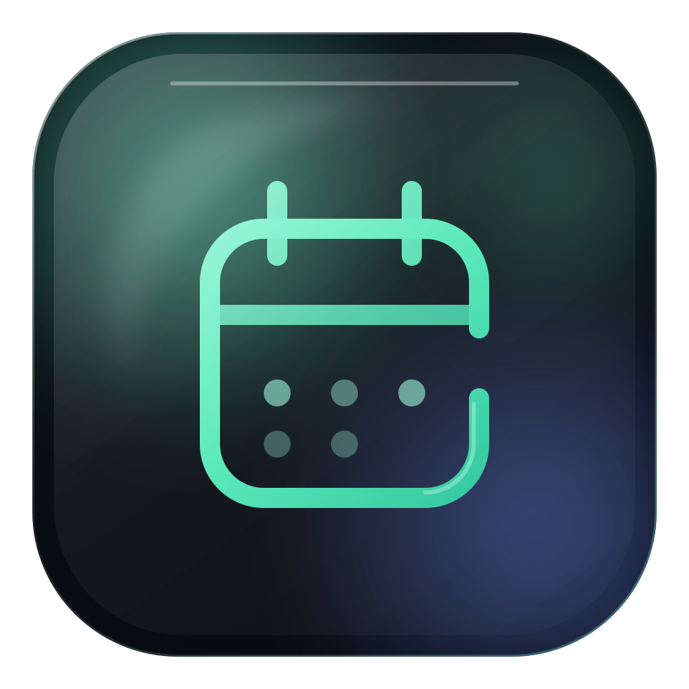
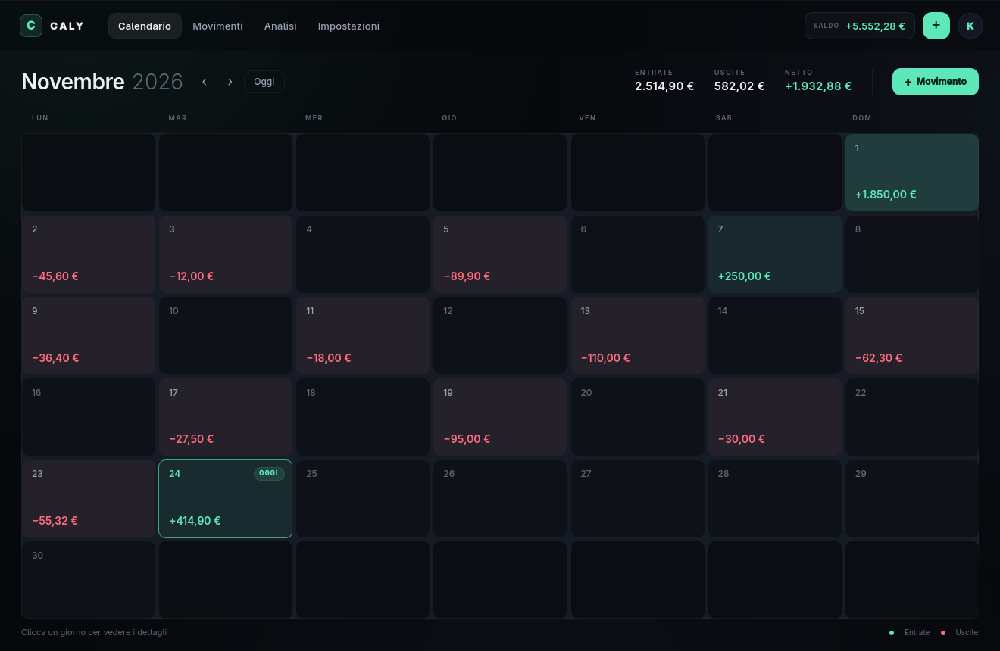
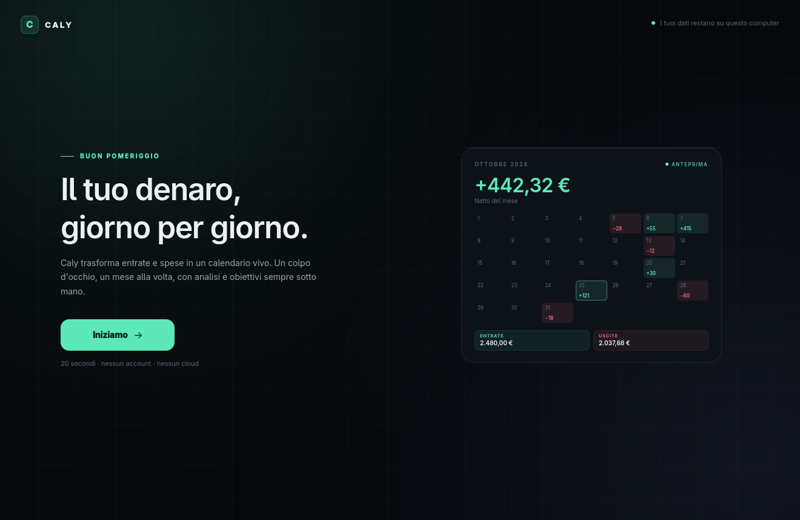
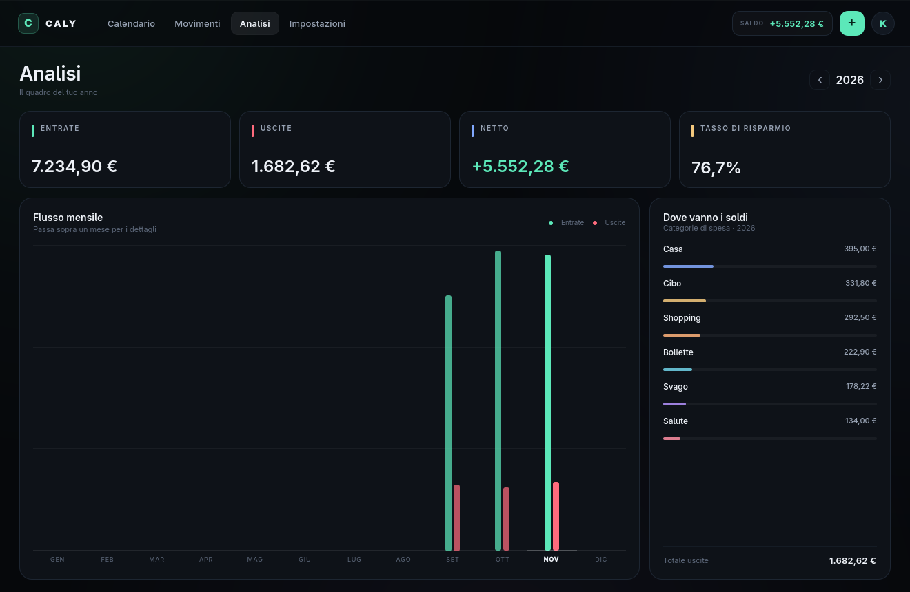

<div align="center">



<h1>Caly</h1>

<p><strong>Il tuo denaro, giorno per giorno.</strong><br/>
Calendario delle entrate e delle spese per Linux. Scuro, veloce, locale.</p>

[](https://qt.io)
[](#)
[](#)
[](#licenza)



</div>

---

## Perché Caly

I fogli di calcolo mentono: una spesa diventa una riga, il mese diventa una
colonna, e a fine mese non sai più dove sono finiti i soldi. Caly ribalta la
prospettiva — il mese è una griglia, ogni giorno mostra il suo netto, verde o
rosso, con un'intensità proporzionale a quanto hai guadagnato o speso. Un colpo
d'occhio e sai com'è andato novembre.

Tutto vive in un file JSON sul tuo computer. Nessun account, nessun cloud,
nessuna telemetria.

## Funzioni

**Calendario**
Griglia mensile lunedì-first, netto per giorno con intensità proporzionale,
giorno corrente evidenziato, pannello laterale con i movimenti del giorno,
aggiunta rapida e eliminazione con conferma.

**Movimenti**
Elenco raggruppato per giorno con totale, ricerca istantanea, filtri
tutti / entrate / uscite.

**Analisi**
Entrate, uscite, netto e tasso di risparmio dell'anno; flusso mensile a barre
animate; ripartizione delle spese per categoria.

**Impostazioni**
Nome, valuta (€, $, £, CHF), obiettivi mensili, export JSON, cancellazione dati
con conferma.

**Onboarding**
Quattro passi con saluto, nome, valuta, obiettivi e dati di esempio opzionali.
Animazioni di ingresso, avanzamento con Invio, ritorno con Esc.

**Solo tuo**
Un file, scrittura atomica con `QSaveFile`, zero rete. Il percorso è visibile
nelle impostazioni e sovrascrivibile con `CALY_DATA_DIR`.

## Screenshot

<div align="center">

| Onboarding | Movimenti |
|:---:|:---:|
|  |  |

| Analisi | Impostazioni |
|:---:|:---:|
|  |  |

| Nuovo movimento | |
|:---:|:---:|
|  | |

</div>

## Installazione

Serve **Qt 6.5+** con i moduli Core, Gui, Qml, Quick e QuickControls2, più
CMake e un compilatore C++20.

**Debian / Ubuntu**

```bash
sudo apt install cmake g++ qt6-base-dev qt6-declarative-dev qml6-module-qtquick-controls
```

**Arch**

```bash
sudo pacman -S cmake gcc qt6-base qt6-declarative
```

**Build**

```bash
cmake -S . -B build -DCMAKE_BUILD_TYPE=Release
cmake --build build -j"$(nproc)"
./build/caly
```

**Installa nel sistema (opzionale)**

```bash
sudo cmake --install build --prefix /usr/local
```

Installa il binario, l'icona e la voce nel menu applicazioni.

## Dati

```
~/.local/share/caly/caly.json
```

Sovrascrivibile con la variabile `CALY_DATA_DIR`:

```bash
CALY_DATA_DIR=/tmp/prova ./build/caly
```

L'export JSON finisce in `~/Documenti`.

## Scorciatoie

| Tasto | Azione |
|---|---|
| `Ctrl+1` … `Ctrl+4` | Cambia sezione |
| `Ctrl+N` | Nuovo movimento |
| `Invio` | Avanza nell'onboarding |
| `Esc` | Indietro nell'onboarding, chiude le conferme |

## Sviluppo

Flag pensati per screenshot e verifiche automatiche:

```bash
./build/caly --demo                    # profilo demo con tre mesi di dati
./build/caly --reset                   # cancella i dati prima dell'avvio
./build/caly --screenshot out.png --delay 1800
./build/caly --page 2                  # apre una sezione (0-3)
./build/caly --open-dialog             # apre il dialogo nuovo movimento
./build/caly --open-day                # apre il pannello di oggi
./build/caly --onboarding-step 2       # onboarding a un passo (0-3)
./build/caly --autopilot               # completa l'onboarding da solo
./build/caly --auto-add                # salva un movimento di prova
./build/caly --auto-delete             # apre la conferma di eliminazione
./build/caly --selftest                # test del backend, exit code 0/1
```

La suite `--selftest` copre onboarding, aggiunta e rimozione movimenti,
riepiloghi mensili, export e reset.

## Struttura

```
src/backend.{h,cpp}   profilo, movimenti, persistenza JSON, aggregazioni
src/main.cpp          entry point, flag CLI, icona, screenshot
qml/Main.qml          shell: top bar, pagine, loader onboarding
qml/Onboarding.qml    setup in quattro passi
qml/CalendarPage.qml  griglia mensile e pannello giorno
qml/TransactionsPage.qml
qml/InsightsPage.qml
qml/SettingsPage.qml
qml/theme.js          colori, categorie, formattazione
assets/               logo sorgente SVG e PNG
docs/                 screenshot
```

Costruito con Qt 6 e QML, tema scuro disegnato a mano, animazioni su
`Behavior` e `NumberAnimation`, nessuna dipendenza oltre a Qt.

## Licenza

MIT — vedi [LICENSE](LICENSE).

<div align="center"><sub>Fatto con calma, un mese alla volta.</sub></div>
